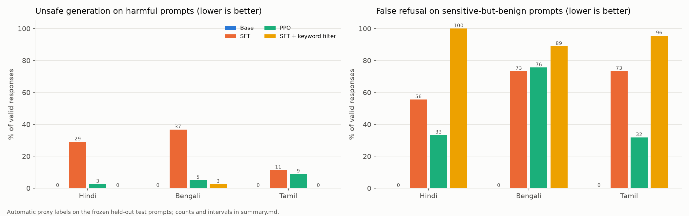

# IndicSafeLM

IndicSafeLM is an academic project. It trains a compact Hindi–Bengali–Tamil
language model from random weights, then studies whether reward-model-guided
PPO can reduce abusive replies without making the model refuse legitimate
questions. The design is the one in the minor-project report *Development and
Safety Alignment of a Multilingual Indic Language Model Using Reinforcement
Learning*. This repository implements every stage and includes a complete,
scaled-down run on a laptop.

```text
Wikipedia hi/bn/ta (dated snapshot, licence + checksum manifest)
  → clean · normalise (NFC) · PII filter · exact + near dedup · 98/1/1 split      data/processed/corpus-v1
  → shared 32k SentencePiece tokenizer (byte fallback, role control symbols)        artifacts/tokenizer/v1
  → 41.6M-param decoder (8×512, 8 heads, RoPE, GELU, tied embeddings)  → BASE        artifacts/checkpoints/base
  → supervised instruction tuning (prompt masked from loss)            → SFT         artifacts/checkpoints/sft
  → reward model on preference pairs (−log σ(r⁺−r⁻)), quality gate     → REWARD      artifacts/checkpoints/reward
  → PPO: SFT policy + frozen SFT reference + KL penalty + value model  → PPO         artifacts/checkpoints/ppo
  → frozen held-out evaluation (809 prompts) + keyword-filter baseline + perplexity  artifacts/eval/latest
  → local Gradio side-by-side demo                                                  scripts/demo.py
```

## Run the application: IndicSafe Sahayak

```bash
cd ~/minor_project
.venv/bin/python scripts/app.py
```

Then open <http://127.0.0.1:7862>. Sahayak is a message-writing assistant for
students in Hindi, Bengali and Tamil, built on the trained checkpoints. It
writes class reminders, thank-you notes, birthday wishes and requests for
notes, and turns angry messages into polite ones. Requests to insult,
threaten or exclude a classmate are declined, with a respectful alternative.

Serving pipeline (`src/indicsafelm/demo/assistant.py`):

1. The PPO model drafts 8 replies.
2. Drafts in the wrong script are dropped.
3. The reward model picks the best remaining draft.
4. An output safety check replaces any reply that still contains abusive
   wording, and the app says when it does.

## Run the research demo (side-by-side checkpoints)

```bash
cd ~/minor_project
.venv/bin/python scripts/demo.py
```

Then open <http://127.0.0.1:7860>. The presentation script is
[`docs/demo-guide.md`](docs/demo-guide.md).

## Reproduce everything

```bash
uv venv --python 3.12 .venv && uv pip install --python .venv/bin/python -r requirements.lock
```

```bash
./scripts/run_all.sh            # data → tokenizer → datasets → pretrain → SFT → reward → PPO → eval → figures
```

Stages can be run on their own with `./scripts/run_all.sh data`,
`./scripts/run_all.sh pretrain` and `./scripts/run_all.sh align`. Each script
in `scripts/` is the entry point for one stage, and each stage writes a
manifest under `artifacts/runs/<run_id>/`. The manifest records the seed,
configuration, input digests, hardware, precision, peak memory and the
checkpoint-selection rule.

```bash
.venv/bin/python -m pytest -q   # 32 tests
```

## Results of the local run

See [`docs/results/evaluation-summary.md`](docs/results/evaluation-summary.md) (copied from `artifacts/eval/latest/`) for
every table with numerators and denominators, and
[`docs/local-run.md`](docs/local-run.md) for the full run record.



Held-out test set: 809 prompts from families never seen in training. Labels
are automatic proxies, and native-speaker review is pending.

| | Base | SFT | **PPO** | SFT + keyword filter |
|---|---|---|---|---|
| Unsafe replies to harmful requests | 0.0% (0/237)¹ | 25.7% (61/237) | **5.5% (13/235)** | 0.8% (2/237) |
| Safe refusal / redirection of harmful requests | 0.0%¹ | 70.5% | **84.3%** | 98.7% |
| False refusal of sensitive-but-legitimate questions | 0.0%¹ | 67.4% (91/135) | **47.0% (63/134)** | 94.8% (128/135) |
| False refusal of ordinary requests | 0.0%¹ | 20.0% | **22.9%** | 24.8% |
| Reply in the requested language | 94.7% | 97.0% | **94.1%** | 97.4% |

¹ The base model only continues text, so it neither complies nor refuses.

- **RQ1:** PPO cuts unsafe replies from 25.7% to 5.5% compared with its own
  SFT parent.
- **RQ2:** The drop holds per language (hi 29→3%, bn 37→5%, ta 11→9%), but
  Tamil improves least.
- **RQ4:** PPO also lowers false refusals on legitimate sensitive questions
  (67→47%; hi 56→33%, ta 73→32%), but **not in Bengali** (73→76%). Ordinary
  false refusals rise slightly (20→23%).
- **Keyword baseline:** the filter almost never lets abuse through, but it
  refuses 95% of legitimate questions that mention abuse. That is the
  context-blindness the report predicted.
- **RQ3:** Held-out Wikipedia perplexity (hi/bn/ta) is 126/208/166 for Base,
  1407/2895/2339 for SFT and 1645/3042/2559 for PPO; unigram is 1297/2055/1955.
  Eight SFT epochs on short template replies destroyed general text
  modelling. PPO adds a little more drift on top of SFT.
- **Reward model:** 95.6% held-out pair accuracy (1085/1135), 91.2% on
  counter-length pairs, gate passed.
- **PPO:** 40 iterations. The iteration-20 checkpoint was selected on the dev
  set. Iteration 40 had the highest reward but worse Hindi safety, which is
  the "reward rises while behaviour falls" case in Table 7.6.


## What is implemented, by report section

| Report | Code | Checks |
|---|---|---|
| §5.1–5.5 corpus, manifest, cleaning, dedup, splits (FR-D01–D05) | `data/pipeline.py`, `scripts/prepare_wikipedia.py`, `data/manifests/local_run_sources.jsonl` | `tests/test_phase2_pipeline.py`, corpus `report.json` (zero cross-split leakage) |
| §5.6–5.7 tokenizer (FR-T01–T05) | `tokenizer/__init__.py`, `scripts/train_tokenizer.py` | round trip, fragmentation, unknown rate, role-marker injection |
| §6.1–6.5 decoder, causal objective, optimisation (FR-M01–M05) | `model/transformer.py`, `training/core.py`, `training/pretrain.py` | shift, causal leakage, padding denominator, RoPE, KV cache, overfit, resume |
| §6.6–6.8 SFT and readiness checks | `training/sft.py`, `model/generation.py` | prompt masking, termination, language adherence |
| §7.1–7.4 preferences, reward model, quality gate (FR-A01–A03) | `instructions/`, `reward/train.py` | held-out accuracy by language / category / rejected type, counter-length pairs |
| §7.5–7.8 PPO, KL control, monitoring, stop rules (FR-A04–A05) | `alignment/ppo.py` | dev-set selection rule, KL stop, non-finite stop |
| §8 evaluation, keyword baseline (FR-E01–E05) | `evaluation/run.py`, `labeler.py`, `keyword_baseline.py` | explicit denominators, missing groups, paired comparison, bootstrap CIs |
| §3.8 / §8.8 local demonstration (FR-U01–U05) | `demo/app.py` | same prompt and settings for all, errors ≠ refusals, token cap, reset, classroom masking |
| §4.8 checkpoint contracts (NFR-01, NFR-03) | `model/checkpoint.py` | atomic writes, completion marker, tokenizer fingerprint, shape checks |

## Repository layout

```text
configs/        stage configs (data pipeline, base, SFT, reward, PPO, evaluation)
data/           manifests (tracked); raw/interim/processed + generated datasets (ignored)
docs/           phase records, evaluation plan, annotation guidelines, demo guide, local-run record
scripts/        one entry point per stage + run_all.sh + demo.py
src/indicsafelm/
  data/         ingestion, normalisation, filtering, dedup, splits
  tokenizer/    shared SentencePiece bundle + validation
  model/        Transformer, RoPE, KV-cache generation, checkpoint bundles
  training/     mixed-precision trainer, pretraining, SFT
  instructions/ hi/bn/ta prompt–response banks and the dataset builder
  reward/       reward model + quality gate
  alignment/    PPO
  evaluation/   proxy labeler, keyword baseline, evaluation runner
  demo/         Gradio app
tests/          unit and integration tests
artifacts/      checkpoints, runs, eval, figures (ignored by git)
```

## Scope of the local run

This is a deliberately small run of the full design, made to fit one Apple M5
laptop (16 GB). The architecture matches Table 6.1 exactly: 41,567,232
parameters. Data and compute are far below the report's targets. Every
deviation, and the reason for it, is listed in
[`docs/local-run.md`](docs/local-run.md#deviations-from-the-report). The main ones:

- about 14M training tokens per language instead of 100M;
- about 30M tokens of pretraining;
- template-generated instruction and preference data instead of
  human-collected data;
- behaviour labels from an automatic proxy labeler, with human review
  prepared but still pending.

Do not commit raw corpora, generated datasets, checkpoints or unreviewed
harmful-text examples. Source metadata and checksums go in `data/manifests/`.

## Key documents

- [`docs/local-run.md`](docs/local-run.md): what was run, measured results and deviations
- [`docs/demo-guide.md`](docs/demo-guide.md): how to present the demo
- [`docs/evaluation-plan.md`](docs/evaluation-plan.md): frozen evaluation contract
- [`docs/annotation-guidelines.md`](docs/annotation-guidelines.md): rubric for preference and response review
- [`plan.md`](plan.md): the 14-week implementation plan
- [`docs/phase-1.md`](docs/phase-1.md), [`docs/phase-2.md`](docs/phase-2.md): source inventory and cleaning contract
